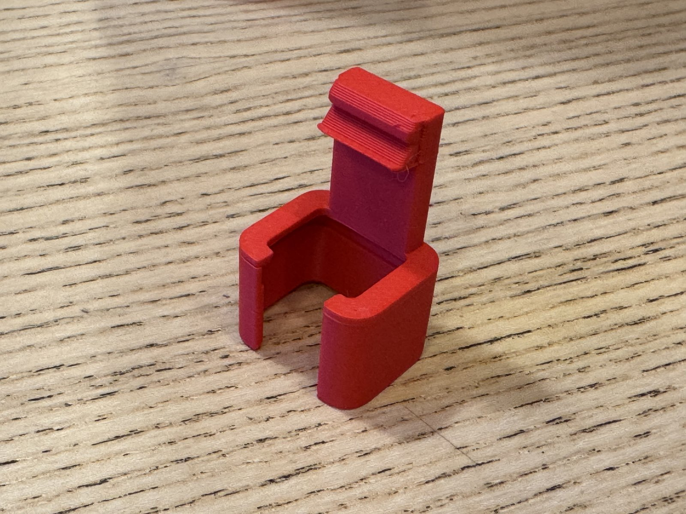
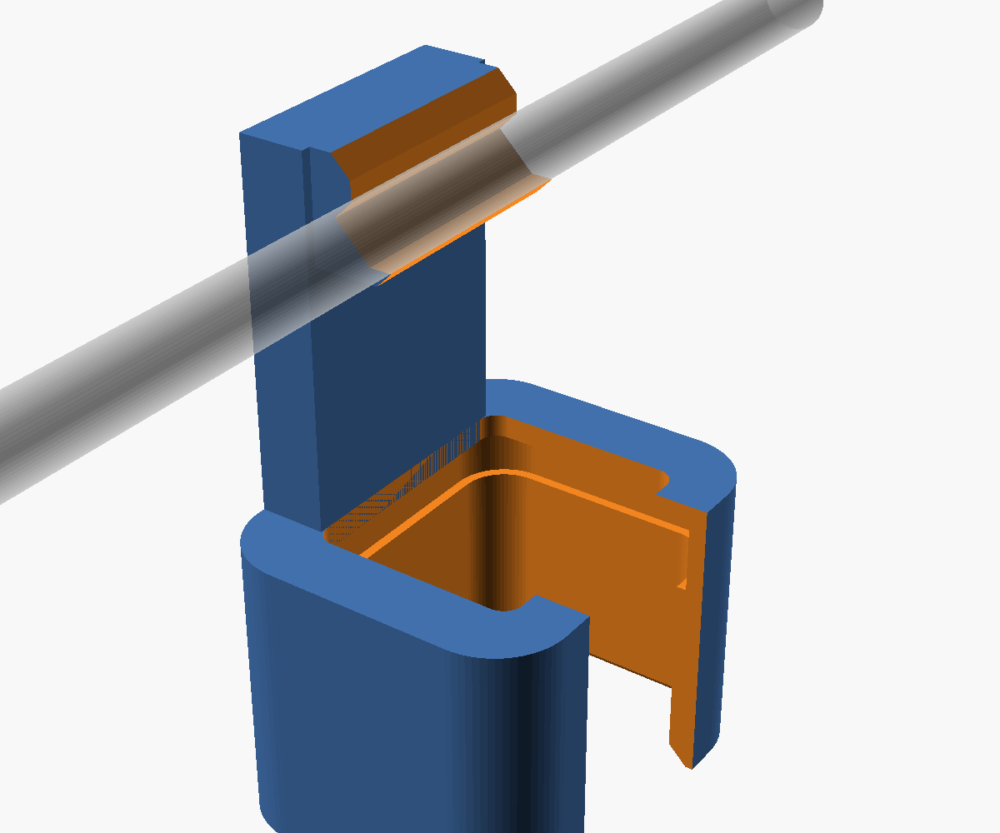
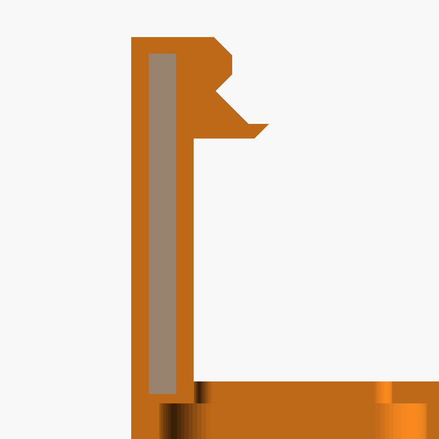
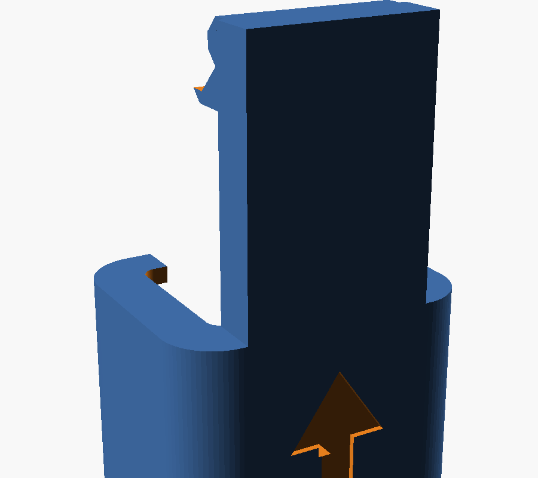

# HIOKI 3481 検電器用 IV線保持ジグ

日置電機（HIOKI）の非接触検電器 **3481** に取り付けて、先端のセンサー部（ノーズ）の横に IV 線を挟んで保持するための 3D プリント用ジグです。
機器に接続されたままの IV 線にも、横からパチッとはめて使えます。

> **非公式品です。** 日置電機株式会社とは関係ありません。
> 使用前後に必ず既知の活線で検電器の動作を確認してください。使用は自己責任でお願いします。

| 実物（PLA で造形） | 3D モデル |
|---|---|
|  |  |

## 特徴

- 検電器の先端ノーズ（平たい板状のセンサー部）の側面に、IV 線を軸と直交させて当てる
- **IV 1.6mm（外径 3.2mm）と IV 2.0mm（外径 3.4mm）の単線**に対応（V 溝で両方とも位置決め）
- 線がノーズを押す力で本体がスリーブの爪に押し付けられ、検電器と線の両方をしっかり保持
- スリーブのボタン面側は窓で開放しているので、ON/OFF ボタンと先端寄りの楕円部を覆わない
- アームの中に**結束バンドを補強材として埋め込める**ポケット付き（任意）

| IV 線の当たり方（線の方向から見た断面） | 結束バンドのポケット（アームの断面） |
|---|---|
|  |  |

## ファイル

| ファイル | 内容 |
|---|---|
| `hioki3481_iv_jig.scad` | OpenSCAD のソース（寸法はすべてパラメータで調整可） |
| `stl/hioki3481_iv_jig_v17.1.stl` | 結束バンドのポケット付き（おすすめ） |
| `stl/hioki3481_iv_jig_v17.1_no-tie.stl` | ポケットなし（補強材を入れない場合） |

## 印刷

- **向き：スリーブ（差し込み口）を下にして立てる。** 寝かせて刷ると、爪が開く方向の力が積層をまたぐので割れやすくなります。
- 材料：PLA で動作確認済み。PETG の場合は層間接着を優先（ノズル 240〜250℃、冷却ファン弱め）。
- 壁（ペリメーター）は 3 周以上がおすすめです。

### 結束バンドの埋め込み（ポケット付きの場合）

補強材として、ヘラマンタイトン AB300（幅 4.9 × 厚 1.5mm）相当の結束バンドを使います。ナイロンなので絶縁物で、検電の感度に影響しません。

1. 結束バンドの平らな部分を **17〜18mm** に切る（ポケットの長さは約 18.7mm。長すぎなければ、短いぶんには問題なし）。
2. Bambu Studio のプレビューで、**ポケットにフタがかぶさる最初の層**（高さ約 33.2〜33.4mm）に一時停止を入れる。
   レイヤースライダーの上の「+」を右クリック →「一時停止を追加」。
3. 止まったら結束バンドをポケットに押し込み、上端が縁から出ていないことを確認して再開する。

ポケットの高さや切る長さは、OpenSCAD でレンダリングしたときのコンソール（ECHO）にも表示されます。

## 使い方

1. 検電器の先端を、**スリーブの後ろ（面取りしてある口）から差し込み**、先端のツバに当たるまで押し込む。
   背中の矢印が差し込む向きです。
   **ボタン面側から横に押し込むと爪が割れます。**
2. IV 線を前方から、ノーズの横の V 溝へ押し込む（爪を越えてパチッと入る）。
3. 検電する。
4. 外すときは、線を前方へ抜いてから検電器を後ろへ抜く。

| 背中の矢印（差し込む向き） | 後ろ（差し込み口）から見たところ |
|---|---|
|  |  |

## 調整できる主なパラメータ

| パラメータ | 初期値 | 内容 |
|---|---|---|
| `clr_d` | 0.3 | 厚み方向の片側すき間。増やすと V 溝も同じだけ自動でずれ、線の押し付け量は変わらない |
| `w_extra` | 0.6 | 幅方向に追加する余裕（合計） |
| `squeeze` | 0.15 | IV 1.6mm をノーズへ押し付ける量（IV 2.0mm はこれ + 約 0.25mm） |
| `open_gap` | 2.8 | V 溝の入口の幅。線を押し込むのが固ければ 3.0 前後に |
| `use_rib` | true | false で結束バンドのポケットなし |
| `tie_w` / `tie_t` | 4.9 / 1.5 | 結束バンドの幅・厚み |
| `tie_clr` | 0.03 | ポケットの片側すき間。入らなければ 0.05〜0.08 に |
| `contact_h` | 5.0 | ノーズ頂点から IV 線の中心までの距離（当てる高さ） |

本体寸法は実機の実測値と、日置電機が公開している外形図（3481A040）を参考にしています。外形図そのものはこのリポジトリには含めていません。

## バージョン

現在の版：**v17.1**　変更履歴は [CHANGELOG.md](CHANGELOG.md) を参照。

## ライセンス

[CC BY-NC 4.0](https://creativecommons.org/licenses/by-nc/4.0/deed.ja)（表示 - 非営利）。詳しくは [LICENSE](LICENSE) を参照。
改変・再配布は自由ですが、作者の表示が必要で、営利目的での利用（販売など）はできません。

---

### English summary

A 3D-printable jig for the HIOKI 3481 non-contact voltage detector that holds a solid IV wire (1.6 mm / 2.0 mm) against the side of the detector's sensor tip. Print standing (sleeve opening down). Optional pocket for a nylon cable tie (4.9 × 1.5 mm) as an insulating stiffener, inserted during a print pause. Insert the detector from the rear of the sleeve only. Unofficial; not affiliated with HIOKI E.E. Corporation. Always verify the detector on a known live circuit before and after use. Use at your own risk. Licensed under CC BY-NC 4.0.
